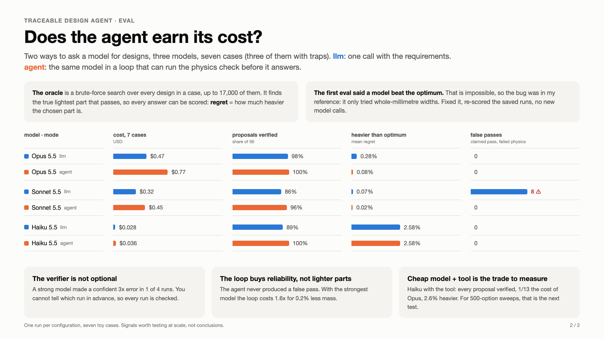

# Traceable Design Agent

A small experiment in one idea: **a design proposed by an AI is not done until it is checked against physics, and every decision traces back to a requirement with its evidence.**

The example part is a bracket. Several proposers compete to suggest designs and make claims about each one. A verifier recomputes every number, fills a verification matrix for each design, flags every claim that does not hold, and marks designs that only pass on paper. Only verified designs can be selected, and the trace says why each lighter option was dropped.




## How it works

```
 requirements ---> proposer ---> designs + claims ---> verifier ---> decision trace
 (REQ-001..007)       ^                                    |         (matrix, labels, findings)
                      +---------- feedback ----------------+
```

**Proposers** (`proposers.py`), three competitors:

| proposer | what it does |
| --- | --- |
| `naive` | Fast grid search that sizes the part for tension and forgets the bending moment. Quick, confident, sometimes wrong. |
| `llm` | A model proposes designs from the requirement alone, as structured output. |
| `agent` | The same model in a tool loop: it can call `check_design` (the physics) as often as it wants before it commits. |

**Requirements and the verification matrix** (`physics.py`). Every design gets one row per requirement:

| id | requirement | method |
| --- | --- | --- |
| REQ-001 | yield margin of safety >= 0 at the yield factor | analysis |
| REQ-002 | ultimate margin of safety >= 0 at the ultimate factor | analysis |
| REQ-003 | tip deflection within the limit | analysis |
| REQ-004 | width and thickness inside the envelope | inspection |
| REQ-005 | thickness is a plate thickness you can actually buy | inspection |
| REQ-006 | REQ-001..003 still hold with 10% more load and a 0.5 mm thinner plate | analysis |
| REQ-007 | thickness / width <= 2, a proxy for lateral stability | inspection |

Margins are written the way structures teams write them: MS = allowable / (factor x applied) - 1.

**Labels** say why a design was rejected: `fails` (physics), `fragile` (passes only at nominal), `not manufacturable` (no such plate), `out of envelope`. Only `verified` designs can be selected.

**Findings** (`verify.py`) catch the proposer, not the design:
- `false_pass`: claimed it passes, but strength or stiffness fails. This is the dangerous one.
- `claim_off`: a claimed margin, deflection or mass is far from the physics.

**Eval** (`evals.py`, `cases.py`). Seven cases. A-D are standard. E-G are hard, each with a trap where the obvious answer is wrong:

| case | trap |
| --- | --- |
| E | a higher ultimate factor, so REQ-002 governs instead of yield; sizing for yield alone fails |
| F | plate capped at 8 mm and a stiff deflection limit; only steel fits, about 1% of the design space passes |
| G | thin plate, where 0.5 mm of tolerance is a big share of the thickness; ignoring it picks a fragile part |

A brute-force oracle finds the true optimum of each case, so the scoreboard can report:
- cases solved, verified rate, false pass rate;
- regret: how much heavier the chosen design is than the optimum;
- tool calls, tokens, cost, time, and which model actually answered (server-side fallback is on).

Crashes are recorded and left out of the scores, so an outage never looks like a bad design.

## Run it

```bash
python3.12 -m venv venv && ./venv/bin/pip install -r requirements.txt
./venv/bin/python -m pytest -q                                   # offline, no API calls
./venv/bin/python -m design_agent.cli run --proposer naive --case A
./venv/bin/python -m design_agent.cli eval --proposers naive     # offline scoreboard
./venv/bin/python -m design_agent.cli eval                       # all three on A-D, needs ANTHROPIC_API_KEY in .env
./venv/bin/python -m design_agent.cli eval --cases E F G --model claude-haiku-5-5 --out results/hard_haiku
./venv/bin/python -m design_agent.cli rescore                    # score saved results again, no model calls
```

Outputs go to `results/`: `report.html` plus the raw `trace.json` or `results.jsonl`.

## Results

All seven cases, one round each, one run per configuration. Raw traces and reports are in `results/eval_opus`, `results/eval_sonnet` and `results/eval_haiku`.

| model | proposer | solved | proposals verified | false passes | mean regret | tool calls | cost, 7 cases |
| --- | --- | --- | --- | --- | --- | --- | --- |
| - | naive | 3 / 7 | 6% | 6% | 150% | 0 | $0 |
| Opus 5.5 | llm | 7 / 7 | 98% | 0% | 0.3% | 0 | $0.47 |
| Opus 5.5 | agent | 7 / 7 | 100% | 0% | 0.1% | 47 | $0.77 |
| Sonnet 5.5 | llm | 6 / 7 | 86% | 14% | 0.1% | 0 | $0.32 |
| Sonnet 5.5 | agent | 7 / 7 | 96% | 0% | <0.1% | 52 | $0.45 |
| Haiku 5.5 | llm | 7 / 7 | 89% | 0% | 2.6% | 0 | $0.03 |
| Haiku 5.5 | agent | 7 / 7 | 100% | 0% | 2.6% | 64 | $0.04 |

What this says:

- **The verifier is not optional.** On case F, Sonnet without the tool got every stress right and every deflection low by exactly 3x. It claimed all 8 designs pass; all 8 fail. The verifier caught every one, so nothing wrong was selected. In three repeat runs (`results/repeat_sonnet_F`) the same model got F right. You cannot tell in advance which run goes wrong, so every run is checked.
- **The tool loop buys reliability, not lighter parts.** Across all models, the agent with `check_design` never produced a false pass and verified 96-100% of its proposals. Mass barely changes.
- **With the strongest model the loop does not pay.** Opus in one call is within 0.3% of the optimum on all seven cases, including the traps. The agent costs 1.6 times as much for 0.2%.
- **A cheap model plus the tool is the interesting trade.** Haiku with the tool verified every proposal, where Haiku alone left 6 of 8 designs fragile on case G. But on case E both picked aluminium instead of titanium, 14% heavier: the tool says whether a design passes, not where the optimum is. Haiku with the tool ran all seven cases for $0.04, about 1/13 of Opus in one call, at 2.6% regret. For a sweep of hundreds of options, that is the number to measure further.
- One run per configuration and seven toy cases. These are signals worth testing at scale, not conclusions.

The first run reported a negative regret: models chose widths like 12.5 mm while the oracle only tried whole millimetres. The oracle now searches widths in 0.1 mm steps, and `rescore` scored the saved traces again without new model calls. Runs before `served_by` was added record the requested model only; the Sonnet repeats confirm Sonnet answered.

## The model and its limits

A solid rectangular cantilever with a load at the tip:

- root bending stress = 6 F L / (b h^2)
- tip deflection = 4 F L^3 / (E b h^3)
- mass = density x b x h x L

Materials: Al 6061-T6, Ti-6Al-4V, Steel 4130 with typical room-temperature handbook values.

This is a toy, on purpose. Real structural work uses FEA, real load cases, fatigue, buckling analysis instead of a proportion rule, joints, and statistically based allowables (MMPDS A/B-basis) instead of typical values. Factors of safety come from the program's standard (for example NASA-STD-5001). The values here are illustrative. What carries over is the pattern: generate many options in parallel, verify each one independently, and keep the evidence for every decision so a reviewer can see why a design was chosen and why the alternatives were not.

## Layout

```
design_agent/schemas.py    requirement, design, proposal, check, matrix row, finding, decision trace
design_agent/physics.py    beam formulas, materials, stock sizes, the verification matrix
design_agent/proposers.py  naive, llm and agent proposers
design_agent/verify.py     verification, labels, selection, feedback for the next round
design_agent/pipeline.py   propose, verify, feed back, repeat
design_agent/cases.py      eval cases and the brute-force oracle
design_agent/evals.py      runs every proposer on every case, scoreboard
design_agent/report.py     HTML reports
design_agent/cli.py        command line
tests/                     offline tests, no API calls
```
