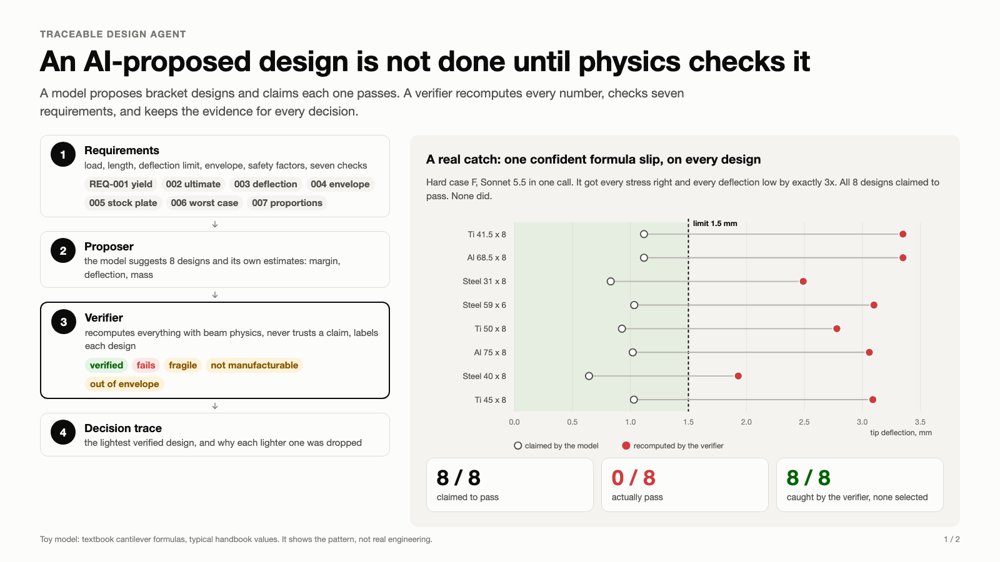

# Traceable Design Agent

A small experiment in one idea: **a design proposed by an AI is not done until it is checked against physics, and every decision traces back to a requirement with its evidence.**

The example part is a bracket. Several proposers compete to suggest designs and make claims about each one. A verifier recomputes every number, fills a verification matrix for each design, flags every claim that does not hold, and marks designs that only pass on paper. Only verified designs can be selected, and the trace says why each lighter option was dropped.




## Live design team

A lead agent reads the requirement and writes a search note for each material. Three specialist agents, one per material, then search in parallel with the physics tool. The verifier, plain code with no model, checks every proposal and picks the lightest part that passes. The dashboard shows each step as it happens: the plan, every physics check, every design as a point in the design space, and the final decision with its verification matrix.

```
 START -> requirements -> approve (interrupt) -> lead -> ...

        +------------------ redesign, with a directive ------------------+
        v                                                                |
 ... lead -> Al specialist ----+                                         |               -> vendor A --+
          -> Ti specialist ----+-> verify -> red team -> monte carlo -> review -> compliance -> vendor B --+-> procurement -> market scan -> END
          -> Steel specialist -+                                                         -> vendor C --+
                                                                                         -> vendor D --+
```

Before the team starts, from a mission brief in plain words:

- **Requirements Desk** (`requirements_desk.py`): an agent drafts the requirement from the brief, and every value carries its source: a quote from the brief or a stated assumption. Code does the arithmetic (load = mass x g x 9.81), fills the defaults it has to assume and checks the result makes sense. The graph then stops with LangGraph `interrupt()` until a person approves or edits the values (`/api/approve` on the dashboard, or Resume in LangGraph Studio). If the edited requirement has no solution, the Verifier says so and the brute-force search confirms it.

After the Verifier picks a design:

- **Red Team Review** (`redteam.py`): an agent tries to break the selected design with a `stress_test` tool (more load, a thinner plate, a longer arm) and names the risks no tool here can test. Code re-runs every attack it claims and computes the breaking point, so a wrong claim from the red team is caught the same way as one from a designer.

- **Fragility and trade-offs** (`fragility.py`, plain code): a Monte Carlo of 2000 samples on the selected design, each with its own load, plate thickness, width, strength and stiffness, gives a probability of failure and shows which scatter matters most. Every verified design also gets a mass, a cost estimate from a neutral reference shop, its worst-case margin and its probability of failure; the dashboard ranks them with sliders for mass, cost and robustness, so "lightest wins" becomes a choice a person can see and change.
- **Chief Engineer review** (`review.py`): the gate before release, and the loop back. The Verifier proves a design meets the written requirements; the Red Team and the Monte Carlo then learn things no requirement states. Code turns those into findings and marks which ones block a release (here: more than 1% of sampled parts fail). An agent reads the findings and proposes ship, redesign or escalate, with a directive for the team. Code has the last word: no release past a blocking finding, no redesign without one, no loop past the round limit, and the dashboard shows when the agent was overruled. A redesign goes back to the lead through a conditional edge; the specialists search again with the directive, and the Verifier now picks the lightest design that also meets the review target. When the rounds run out the run escalates: compliance still reports, but no request for quote goes out. On case A the lightest verified part, Al 15 x 25 mm at 152 g, fails in 1.9% of samples; the review sends it back and the second round ships Ti 11.8 x 20 mm at 157 g (recording `20261114-203431_A_haiku-5-5`).
- **Compliance Engine** (`compliance.py`): about twenty rules, each checked by plain code against the selected part, grouped into structural, materials, manufacturing, fracture and fatigue, and procurement. Each rule names its source (for example NASA-STD-5001, MMPDS, MSFC-STD-3029, ASTM E595, MIL-STD-889, DFARS 252.225-7009, AS9100) and shows how far the part is from the limit. The same rules run on every verified design, as a matrix. A review agent then explains the gaps and proposes actions; it never changes a status. Illustrative, not a compliance determination.
- **Supplier Desk** (`suppliers.py`, sample vendors in `data/approved_vendors.json`): a request for quote goes to four approved vendors at once. Each vendor is an agent with its own `check_stock` and `estimate_job` tools and decides to bid or not. Code then checks every quote: is the vendor eligible (AS9100, DFARS melt source, material), and does the quoted price match the shop's own estimate? Code ranks the valid bids; a procurement agent writes the memo. Vendors, rates and lead times are made up.
- **Market scan** (`sourcing.py`): a model with the web search tool finds real shops outside the approved list. A shop is shown only if its link came back in the search results.

## When a requirement changes

A finished run can be changed: a heavier payload, a longer arm, a bigger order. A change run (`impact.py`) starts from the saved run and works like a build system:

- **Diff.** Code lists the fields that changed and whether each change is tighter or looser.
- **Reverify.** Code checks every design of the saved run again under the new requirement. This is free and shows what the change broke.
- **Search.** The design search is kept when no agent could do better: every change is tighter and the selected design still passes. If a change is looser, or the selected design now fails, the specialists search again and are told which of their old designs still pass.
- **Steps.** Every later step declares its inputs: the selected design, the requirement fields it reads, the quotes. The inputs are hashed. A step whose hash matches the saved run sends its saved events again, marked reused, with no model call. A step whose hash differs runs again, and the event names the inputs that changed. A vendor quote reads the arm length and the order quantity, not the load, so a heavier payload on a design that still passes reruns the Red Team, the Monte Carlo, the review and compliance, and reuses all four quotes.

The dashboard shows the diff, the old designs before and after, and one row per step with "reused" or "ran again" and why. Reused steps are dashed in the pipeline.

```bash
./venv/bin/python -m design_agent.cli team --base <run> --set load_n=2800          # a change run without the browser
./venv/bin/python -m design_agent.cli team --base <run> --set qty=50               # only the quotes and the cost table run again
```

## Evidence ledger and the Design Package

- **Ledger** (`ledger.py`). Every event of a run gets a number and a hash of itself plus the hash before it. Change, drop or reorder one recorded event and every later hash stops matching, so `verify()` says where a recording was altered. This is tamper-evident, not tamper-proof: someone who rewrites the whole file can rewrite the whole chain, so the last hash is printed on the package and can be kept somewhere else. The run also records the commit it was made with.
- **Design Package** (`package.py`). One HTML document a reviewer can read, print and sign, built from the recording alone with no model call: release status, the requirement with the source of every value, the verification matrix, every alternative and why it was rejected, the Red Team, the Monte Carlo, each review round with any overruled agent decision, compliance, quotes, one list of open items, the change history, cost per agent, and the ledger: every decision in order, marked as made by an agent, by code or by a person. Text written by agents or found on the web is escaped.

```bash
./venv/bin/python -m design_agent.cli package <run>              # writes results/packages/design-package-<run>.html, checks the ledger
```

On the dashboard the Design Package button opens the same document for the run on screen (`/api/package?name=<run>`).

Built with LangGraph (`team.py`, `graph_agent.py`), served by FastAPI (`server.py`) with server-sent events. Every live run is recorded to `results/live/` and can be replayed with no API calls.

```bash
./venv/bin/python -m design_agent.cli serve                      # dashboard at http://127.0.0.1:8765
./venv/bin/python -m design_agent.cli team --case F              # one run without the browser, recorded for replay
```

The same team graph also opens in LangGraph Studio: run `./venv/bin/langgraph dev` in the project folder, open the Studio link it prints, and start a run with `{"case": "F"}`.

## How it works

```
 requirements ---> proposer ---> designs + claims ---> verifier ---> decision trace
 (REQ-001..007)       ^                                    |         (matrix, labels, findings)
                      +---------- feedback ----------------+
```

**Proposers** (`proposers.py`, `graph_agent.py`):

| proposer | what it does |
| --- | --- |
| `naive` | Fast grid search that sizes the part for tension and forgets the bending moment. Quick, confident, sometimes wrong. |
| `llm` | A model proposes designs from the requirement alone, as structured output. |
| `agent` | The same model in a tool loop: it can call `check_design` (the physics) as often as it wants before it commits. |
| `langgraph` | The same agent built as a LangGraph graph (nodes, edges, state) instead of a plain loop. |

**Requirements and the verification matrix** (`physics.py`). Every design gets one row per requirement:

| id | requirement | method |
| --- | --- | --- |
| REQ-001 | yield margin of safety >= 0 at the yield factor | analysis |
| REQ-002 | ultimate margin of safety >= 0 at the ultimate factor | analysis |
| REQ-003 | tip deflection within the limit | analysis |
| REQ-004 | width and thickness inside the envelope | inspection |
| REQ-005 | thickness is a plate thickness you can actually buy | inspection |
| REQ-006 | REQ-001..003 still hold with 10% more load and a 0.5 mm thinner plate | analysis |
| REQ-007 | thickness / width <= 2, a proxy for lateral stability | inspection |

Margins are written the way structures teams write them: MS = allowable / (factor x applied) - 1.

**Labels** say why a design was rejected: `fails` (physics), `fragile` (passes only at nominal), `not manufacturable` (no such plate), `out of envelope`. Only `verified` designs can be selected.

**Findings** (`verify.py`) catch the proposer, not the design:
- `false_pass`: claimed it passes, but strength or stiffness fails. This is the dangerous one.
- `claim_off`: a claimed margin, deflection or mass is far from the physics.

**Eval** (`evals.py`, `cases.py`). Seven cases. A-D are standard. E-G are hard, each with a trap where the obvious answer is wrong:

| case | trap |
| --- | --- |
| E | a higher ultimate factor, so REQ-002 governs instead of yield; sizing for yield alone fails |
| F | plate capped at 8 mm and a stiff deflection limit; only steel fits, about 1% of the design space passes |
| G | thin plate, where 0.5 mm of tolerance is a big share of the thickness; ignoring it picks a fragile part |

A brute-force oracle finds the true optimum of each case, so the scoreboard can report:
- cases solved, verified rate, false pass rate;
- regret: how much heavier the chosen design is than the optimum;
- tool calls, tokens, cost, time, and which model actually answered (server-side fallback is on).

Crashes are recorded and left out of the scores, so an outage never looks like a bad design.

## Run it

```bash
python3.12 -m venv venv && ./venv/bin/pip install -r requirements.txt
./venv/bin/python -m pytest -q                                   # offline, no API calls
./venv/bin/python -m design_agent.cli run --proposer naive --case A
./venv/bin/python -m design_agent.cli eval --proposers naive     # offline scoreboard
./venv/bin/python -m design_agent.cli eval                       # all proposers on A-D, needs ANTHROPIC_API_KEY in .env
./venv/bin/python -m design_agent.cli eval --cases E F G --model claude-haiku-5-5 --out results/hard_haiku
./venv/bin/python -m design_agent.cli rescore                    # score saved results again, no model calls
```

Outputs go to `results/`: `report.html` plus the raw `trace.json` or `results.jsonl`.

## Results

All seven cases, one round each, one run per configuration. Raw traces and reports are in `results/eval_opus`, `results/eval_sonnet` and `results/eval_haiku`.

| model | proposer | solved | proposals verified | false passes | mean regret | tool calls | cost, 7 cases |
| --- | --- | --- | --- | --- | --- | --- | --- |
| - | naive | 3 / 7 | 6% | 6% | 150% | 0 | $0 |
| Opus 5.5 | llm | 7 / 7 | 98% | 0% | 0.3% | 0 | $0.47 |
| Opus 5.5 | agent | 7 / 7 | 100% | 0% | 0.1% | 47 | $0.77 |
| Sonnet 5.5 | llm | 6 / 7 | 86% | 14% | 0.1% | 0 | $0.32 |
| Sonnet 5.5 | agent | 7 / 7 | 96% | 0% | <0.1% | 52 | $0.45 |
| Haiku 5.5 | llm | 7 / 7 | 89% | 0% | 2.6% | 0 | $0.03 |
| Haiku 5.5 | agent | 7 / 7 | 100% | 0% | 2.6% | 64 | $0.04 |
| Haiku 5.5 | langgraph | 7 / 7 | 100% | 0% | 4.4% | 56 | $0.05 |

What this says:

- **The verifier is not optional.** On case F, Sonnet without the tool got every stress right and every deflection low by exactly 3x. It claimed all 8 designs pass; all 8 fail. The verifier caught every one, so nothing wrong was selected. In three repeat runs (`results/repeat_sonnet_F`) the same model got F right. You cannot tell in advance which run goes wrong, so every run is checked.
- **The tool loop buys reliability, not lighter parts.** Across all models, the agent with `check_design` never produced a false pass and verified 96-100% of its proposals. Mass barely changes.
- **With the strongest model the loop does not pay.** Opus in one call is within 0.3% of the optimum on all seven cases, including the traps. The agent costs 1.6 times as much for 0.2%.
- **A cheap model plus the tool is the interesting trade.** Haiku with the tool verified every proposal, where Haiku alone left 6 of 8 designs fragile on case G. But on case E both picked aluminium instead of titanium, 14% heavier: the tool says whether a design passes, not where the optimum is. Haiku with the tool ran all seven cases for $0.04, about 1/13 of Opus in one call, at 2.6% regret. For a sweep of hundreds of options, that is the number to measure further.
- **Plain loop vs LangGraph.** The same agent built both ways (`proposers.py`, `graph_agent.py`) verified every proposal with no false passes. LangGraph used 44% more tokens, partly because this version makes one extra call to format the final answer. The regret gap comes from two cases (C and G) in one run, which is too little to credit to the framework.
- One run per configuration and seven toy cases. These are signals worth testing at scale, not conclusions.

The first run reported a negative regret: models chose widths like 12.5 mm while the oracle only tried whole millimetres. The oracle now searches widths in 0.1 mm steps, and `rescore` scored the saved traces again without new model calls. Runs before `served_by` was added record the requested model only; the Sonnet repeats confirm Sonnet answered.

## The model and its limits

A solid rectangular cantilever with a load at the tip:

- root bending stress = 6 F L / (b h^2)
- tip deflection = 4 F L^3 / (E b h^3)
- mass = density x b x h x L

Materials: Al 6061-T6, Ti-6Al-4V, Steel 4130 with typical room-temperature handbook values.

This is a toy, on purpose. Real structural work uses FEA, real load cases, fatigue, buckling analysis instead of a proportion rule, joints, and statistically based allowables (MMPDS A/B-basis) instead of typical values. Factors of safety come from the program's standard (for example NASA-STD-5001). The values here are illustrative. What carries over is the pattern: generate many options in parallel, verify each one independently, and keep the evidence for every decision so a reviewer can see why a design was chosen and why the alternatives were not.

## Layout

```
design_agent/schemas.py    requirement, design, proposal, check, matrix row, finding, decision trace
design_agent/physics.py    beam formulas, materials, stock sizes, the verification matrix
design_agent/proposers.py  naive, llm and agent proposers
design_agent/graph_agent.py the same agent built with LangGraph
design_agent/verify.py     verification, labels, selection, feedback for the next round
design_agent/pipeline.py   propose, verify, feed back, repeat
design_agent/team.py       the LangGraph team: every node from the brief to the quotes
design_agent/review.py     Chief Engineer review: the gate, the decision rules, the redesign loop
design_agent/impact.py     change impact: diff, reverify, the step cache, snapshots
design_agent/ledger.py     hash chain over the events, chain check, the decision record
design_agent/package.py    the Design Package: one HTML document from a recording
design_agent/cases.py      eval cases and the brute-force oracle
design_agent/evals.py      runs every proposer on every case, scoreboard
design_agent/report.py     HTML reports
design_agent/cli.py        command line
tests/                     offline tests, no API calls
```
